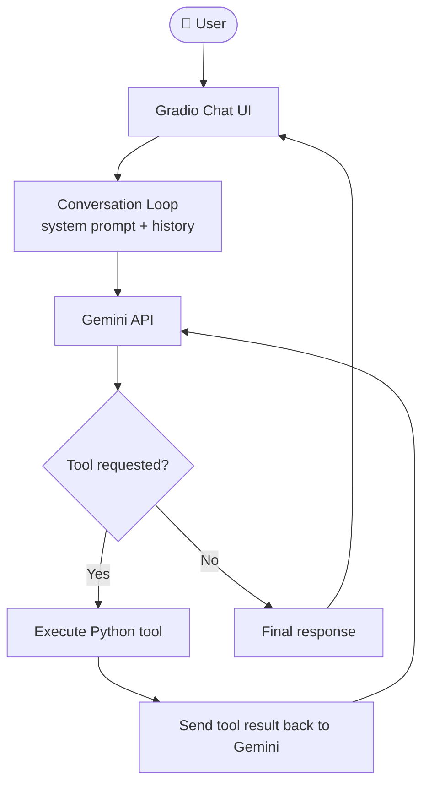

<div align="center">

# 🤖 Digital Twin AI

### An AI version of me that answers questions about my career, skills, and projects.

Built with **Gemini**, **Gradio**, and **agentic tool calling**.

<p>
  <a href="https://digital-twin-ai-y5iu.onrender.com/"></a>
</p>

<p>
  
  
  
  
  
  
</p>

</div>

---

## 📖 Overview

**Digital Twin AI** is a conversational agent that represents my professional profile. Instead of reading a static resume, visitors can simply *ask*: about my experience, technical skills, projects, or background. The twin answers in context, and can call Python tools to carry out structured tasks.

It is also a hands-on demonstration of how to build an **LLM agent with tool calling**: a system prompt for grounding, a conversation loop, and Python functions the model can invoke on its own.

> 💡 **Try asking:** *"What does Hiren work on at IBM?"*, *"Which projects show his full-stack skills?"*, or *"Plan the steps to evaluate this candidate for a backend role."*

<!-- Add a screenshot or GIF here for maximum impact:
<p align="center"></p>
-->

## 📑 Table of Contents

- [Features](#-features)
- [Tech Stack](#-tech-stack)
- [Architecture](#-architecture)
- [How It Works](#-how-it-works)
- [Getting Started](#-getting-started)
- [Project Structure](#-project-structure)
- [Deployment](#-deployment)
- [Environment Variables](#-environment-variables)
- [Roadmap](#-roadmap)
- [Author](#-author)

## ✨ Features

| | Feature | Description |
|---|---|---|
| 💬 | **Interactive conversations** | Chat naturally with an AI representation of my professional profile. |
| 🧠 | **Gemini-powered reasoning** | Google's Gemini API generates contextual, grounded responses. |
| 🛠️ | **Agentic tool calling** | The model decides when to invoke Python functions to perform structured tasks. |
| 📋 | **Checklist-based planning** | Breaks tasks into steps, tracks progress, and completes actions through tools. |
| 🎨 | **Custom chat interface** | Gradio UI with custom styling and one-click example prompts. |
| ⚡ | **Context-aware answers** | A dedicated system prompt plus conversation history keeps responses on-topic. |

## 🧰 Tech Stack

| Technology | Purpose |
|---|---|
| **Python** | Application logic and tool execution |
| **Gradio** | Interactive chat interface |
| **Google Gemini API** | Language model and reasoning |
| **OpenAI Python SDK** | Client for Gemini's OpenAI-compatible endpoint |
| **Rich** | Formatted terminal output |
| **python-dotenv** | Local environment variable management |
| **Git & GitHub** | Version control and source hosting |
| **Render** | Live deployment |

## 🏗️ Architecture



## ⚙️ How It Works

1. The user sends a message through the **Gradio** chat interface.
2. The app combines it with the **system prompt** and **conversation history**.
3. **Gemini** either answers directly or requests one of the available tools.
4. The **Python tool handler** runs the requested function and returns the result.
5. The result goes back to Gemini, which continues reasoning or writes the final reply.
6. Gradio displays the answer.

This loop lets the model coordinate with real code instead of relying only on generated text.

## 🚀 Getting Started

### Prerequisites

- Python **3.10+**
- A **Google Gemini API key** ([get one free from Google AI Studio](https://aistudio.google.com/apikey))
- Git

### 1. Clone the repository

```bash
git clone https://github.com/HirenTri/digital-twin-ai.git
cd digital-twin-ai
```

### 2. Create and activate a virtual environment

```bash
python -m venv .venv
```

| OS | Command |
|---|---|
| macOS / Linux | `source .venv/bin/activate` |
| Windows | `.venv\Scripts\activate` |

### 3. Install dependencies

```bash
pip install -r requirements.txt
```

### 4. Configure environment variables

Create a `.env` file in the project root:

```env
GOOGLE_API_KEY=your_gemini_api_key
```

> ⚠️ **Never commit your `.env` file or expose your API key** in a public repository.

### 5. Run the app

```bash
python app.py
```

Open the local URL printed in the terminal (usually `http://127.0.0.1:7860`).

## 📁 Project Structure

```text
digital-twin-ai/
├── app.py             # Gradio interface and Gemini conversation loop
├── context.py         # Digital twin system prompt and profile context
├── tools.py           # Tool definitions and Python tool handlers
├── styles.py          # UI styles, JavaScript, and example prompts
├── requirements.txt   # Python dependencies
├── .gitignore         # Excluded files and secrets
└── README.md          # Project documentation
```

## 🌐 Deployment

**Live app:** [digital-twin-ai-y5iu.onrender.com](https://digital-twin-ai-y5iu.onrender.com/)

The app is deployed on **Render**. On a free instance, the service spins down after inactivity, so the **first request may take 30–60 seconds** while it wakes up.

## 🔐 Environment Variables

| Variable | Required | Description |
|---|---|---|
| `GOOGLE_API_KEY` | ✅ | API key for the Gemini API |
| `PORT` | Deployment only | Port provided by Render |

Keep secrets in environment variables, never in source files.

## 🛣️ Roadmap

- [x] Gemini-powered chat with a custom system prompt
- [x] Agentic tool calling
- [x] Checklist-based planning tools
- [x] Live deployment on Render
- [ ] Persistent conversation memory
- [ ] Expanded toolset with more useful actions
- [ ] Stronger tool-execution validation and error handling
- [ ] Automated tests for tool calls and conversation flows
- [ ] Response streaming and better loading feedback
- [ ] Monitoring for API failures and usage limits

## 🤝 Contributing

Ideas and suggestions are welcome. Open an [issue](https://github.com/HirenTri/digital-twin-ai/issues) or submit a pull request.

## 👨‍💻 Author

**Hiren Trivedi** — Software Engineer · AI Enthusiast · Full-Stack Developer

Interested in AI agents, LLM-powered applications, and building practical products.

[](https://github.com/HirenTri)
[](https://www.linkedin.com/in/hiren-trivedi-65a826250/)
[](https://digital-twin-ai-y5iu.onrender.com/)

---

<div align="center">

If you find this project interesting, consider giving it a ⭐

*Built with Python, Gradio, and Gemini.*

</div>
